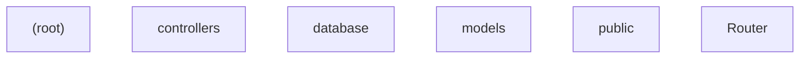

# Project documentation

## What this system is

A small repository of 13 file(s) across 6 area(s), carrying
0 top-level declaration(s).

## How it works

- `(root)` — 3 file(s)
- `controllers` — 1 file(s)
- `database` — 1 file(s)
- `models` — 1 file(s)
- `public` — 6 file(s)
- `Router` — 1 file(s)

## Component diagram

## Areas

### (root)

_No exported declarations were found in the provided source._

### controllers

_No exported declarations were found in the provided source._

### database

_No exported declarations were found in the provided source._

### models

_No exported declarations were found in the provided source._

### public

_No exported declarations were found in the provided source._

### Router

_No exported declarations were found in the provided source._

## Setup & running

Derived from the provided project files. Source fingerprint
`85f2ebb74128`.
